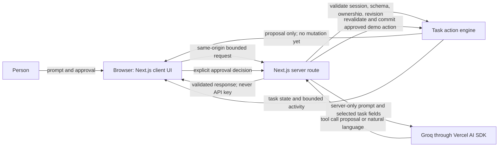

# System boundaries

## Responsibilities

**Browser:** board, assistant, task cards, proposal preview, approval, progress, errors, and activity. It holds transient form state and never receives the Groq key or server credentials.

**Server:** request and origin checks, body limits, session integrity, task ownership, tool schemas, proposal expiry and revision, archive confirmation, commit, undo, rate limits, and bounded logs. It calls the model and returns a typed proposal or safe response.

**Model:** receives only the prompt and task fields needed for the request. It may invoke read-only search and propose one mutation. It has no approval capability or mutation executor. Output is untrusted and must pass server validation.

**Data and services:** fictional tasks and short-lived session state; Groq for model inference; Vercel for hosting and sensitive server variables. No external task service, email, analytics, file upload, or user database is connected.

## Security checklist

- Keep `GROQ_API_KEY` and the session signing secret in server-only Vercel variables.
- Validate request shape, origin, size, enums, task ownership, revision, proposal identity, and expiry on the server.
- Require explicit approval for every write and typed confirmation for archive.
- Treat prompts, task descriptions, and model output as untrusted.
- Bound session size, activity history, request rate, and proposal lifetime.
- Never log prompts, credentials, or session cookies.
- Use HTTPS and HttpOnly, SameSite, Secure production cookies.
- Explain the demo's lack of durable shared storage and distributed replay protection.
